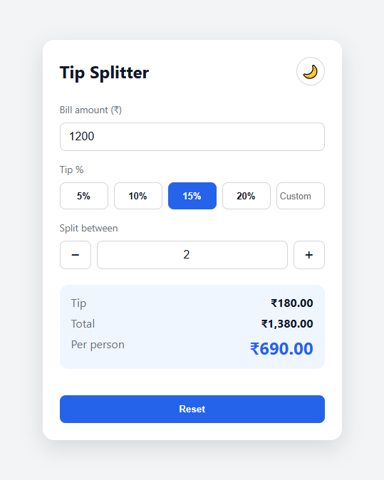
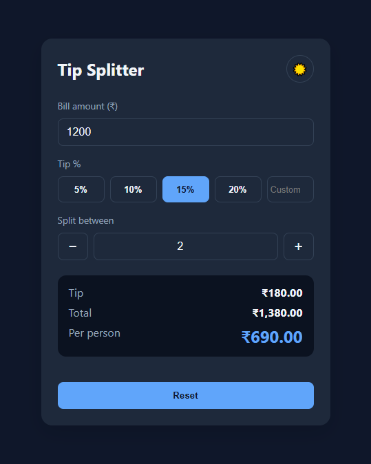

# Tip Splitter

A lightweight tip calculator and bill splitter that runs entirely in the browser. Enter a bill, choose a tip, pick how many people are paying, and get an instant per-person breakdown.

Built with [Cursor](https://cursor.com) for **MLH Global Hack Week: Open Source — Challenge 1: Build a Mini App with Cursor**.


## Screenshots

| Light mode | Dark mode |
| :---: | :---: |
|  |  |

## Features

- **Instant calculation** — tip, total, and per-person share update as you type
- **Flexible tip selection** — one-tap presets (5 / 10 / 15 / 20 %) or a custom percentage
- **Bill splitting** — stepper controls to split between any number of people
- **Dark / light theme** — one-click toggle, remembers your preference and respects the OS setting on first load
- **Input validation** — inline error messages for negative amounts or zero people
- **Zero dependencies** — plain HTML, CSS, and JavaScript; no build step, no framework
- **Responsive & accessible** — works on mobile, uses semantic labels and ARIA attributes

## Getting Started

### Run locally

Clone the repository and open `index.html` in any modern browser:

```bash
git clone https://github.com/surajns0033-collab/tip-splitter-cursor.git
cd tip-splitter-cursor
start index.html        # Windows
# open index.html       # macOS
# xdg-open index.html   # Linux
```

Or serve it with any static file server:

```bash
python -m http.server 8000
# then visit http://localhost:8000
```

## Project Structure

```
.
├── index.html        # Markup and layout
├── style.css         # Styling, theming (CSS custom properties)
├── app.js            # Calculation logic, event handling, theme persistence
├── screenshots/      # App screenshots used in this README
└── README.md
```

## How It Works

1. The bill amount, tip percentage, and number of people are read from the inputs on every change.
2. `tip = bill × tipPercent / 100`, `total = bill + tip`, `perPerson = total / people`.
3. Results are formatted using `Intl` (`en-IN` locale) and rendered to the DOM.
4. The selected theme is stored in `localStorage` and applied via a `data-theme` attribute, with colors driven by CSS custom properties.

## Built with Cursor

This project was created from a blank folder using Cursor as an AI pair programmer:

- **Scaffolding** — the initial HTML, CSS, and JavaScript were generated from a single-sentence description of the app.
- **Iteration** — follow-up prompts added the custom tip input, the people stepper, dark mode with persistence, and input validation.
- **Debugging** — while testing in the browser, Cursor identified and fixed a layout bug where the "Custom" tip placeholder was being clipped.

## Roadmap

- [ ] Round per-person amounts up/down to the nearest whole unit
- [ ] Currency selector
- [ ] Shareable result link

## License

This project is released under the [MIT License](LICENSE).
